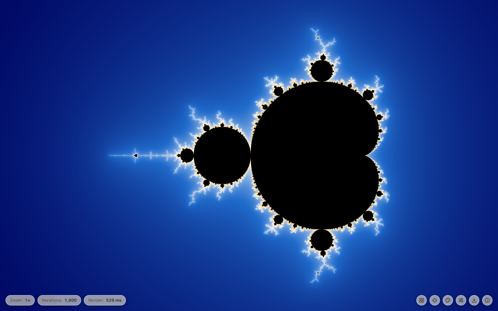
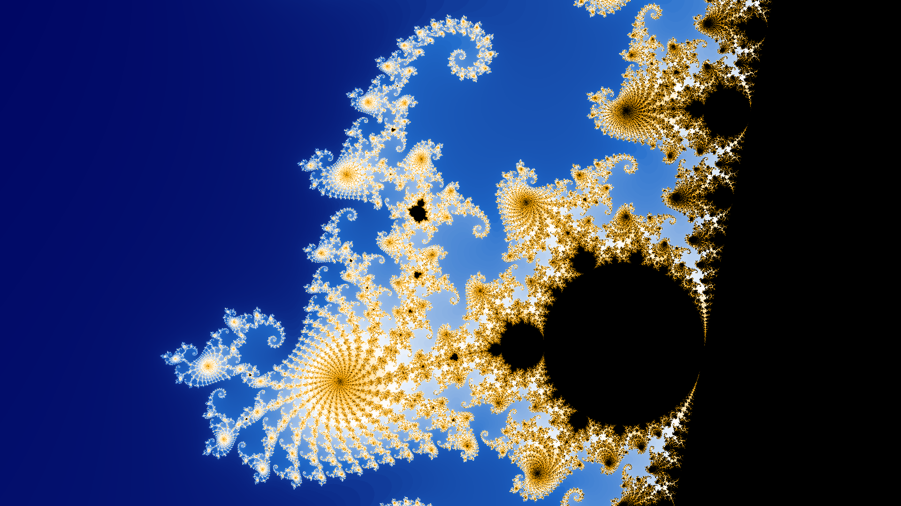
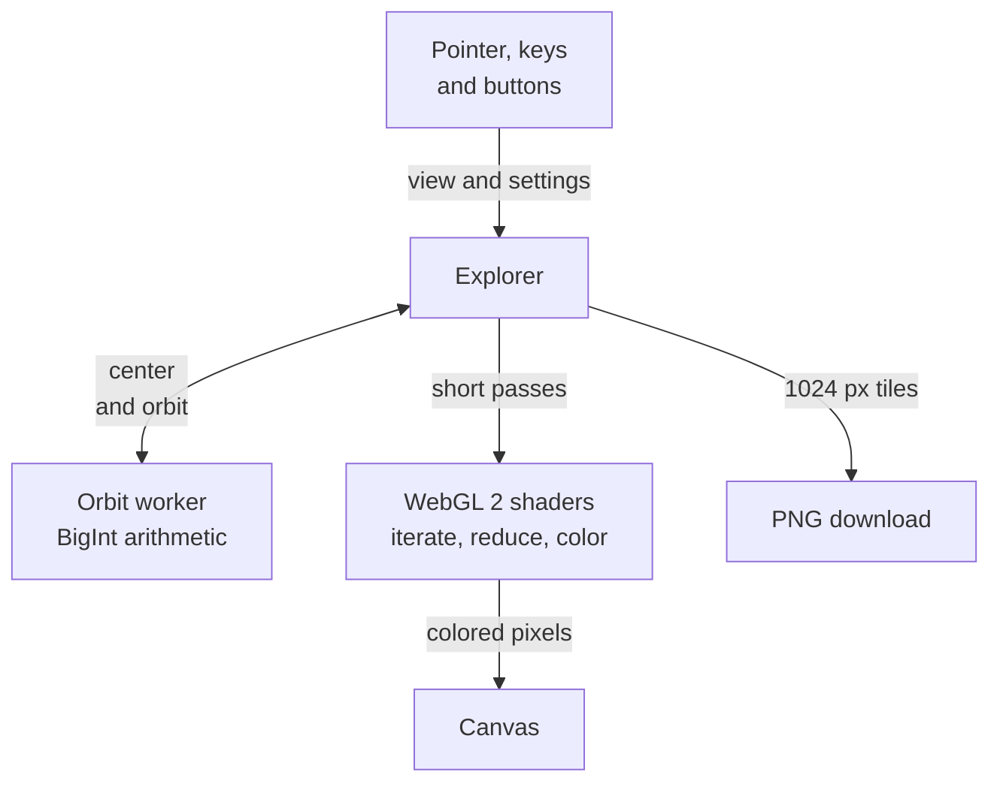

# Mandelbrot explorer


An interactive web app for exploring the [Mandelbrot set](https://en.wikipedia.org/wiki/Mandelbrot_set) in real time and downloading images of it at up to 8K. It renders on the GPU with WebGL 2 and zooms to a plane width of 1e-300, far beyond the limit of about 1e-13 where 64-bit floating point loses precision. I started the project in 2024 as a Python image generator and rebuilt it in TypeScript to make interactive exploration possible. It runs at [denisshehu.github.io/Mandelbrot](https://denisshehu.github.io/Mandelbrot/).



## Contents

- [Features](#features)
- [Screenshots](#screenshots)
- [Tech stack](#tech-stack)
- [How it works](#how-it-works)
- [Getting started](#getting-started)
- [Project structure](#project-structure)
- [License](#license)

## Features

You can:

- pan by dragging or with the arrow keys, and zoom by scrolling, pinching, double-clicking or pressing `+` and `−`
- open eight presets, each fitted to the window, from the full set and its best-known valleys to a filament at a plane width of 1e-250
- enter an exact center and width with any number of digits, writing a value with a long run of zeros as a sum such as `1+6.2e-251`
- copy a link that reopens the same location and settings
- set the maximum iterations manually, or let them increase automatically with the zoom
- choose one of nine color schemes
- adjust the escape radius, and increase the cell size to render faster at a lower resolution
- download the view as a PNG in Full HD, QHD, 4K, 5K, 8K, the window size or a custom size

The settings sit behind a row of round buttons at the bottom right, and each button opens a pop-up above it, so the set fills the whole screen. A "Reset view" button appears once you leave the starting view. Rendering is progressive: the page stays responsive during deep renders, the previous view remains on screen until new pixels replace it, and the color scale stays fixed until the view is complete. Views that take longer than 2 seconds show a "Slow render" notice, whose information button explains how to render faster and what each option costs. A "Maximum zoom reached" notice appears at the zoom limit. Coloring uses the escape-time algorithm with smooth iteration counts on a logarithmic scale, as in the original Python version.

## Screenshots

Each image is a Full HD download from the app.

| Full set | Flower |
| --- | --- |
|  |  |

| Seahorse valley | Lightning |
| --- | --- |
|  |  |

## Tech stack

| Layer | Technologies |
| --- | --- |
| Frontend | TypeScript 7, Vite 8, no UI framework |
| Rendering | WebGL 2 with GLSL ES 3.0 shaders, a Web Worker with BigInt arithmetic |
| Testing | Vitest 5 |
| Hosting | GitHub Pages, deployed with GitHub Actions |

## How it works

The site is static and runs entirely in the browser, so it requires no server. When the view changes, a Web Worker computes the orbit of a single reference point with exact BigInt arithmetic. The GPU then computes every pixel as a small offset from that orbit, in short passes of about 14 ms each, which keeps the page responsive. After each pass, the image is reduced to its lowest and highest iteration counts, which define the color scale.



### Deep zoom

The Python version computed each pixel with 64-bit floats. Below a plane width of about 1e-13, neighboring pixels round to the same coordinate, and the image breaks up into blocks. At a width of 1e-15, a row of 3840 pixels contains only 10 distinct coordinates. The image also turned black before that point, because the fixed limit of 1000 iterations classified every slowly escaping point as part of the set.

This version stores the center as a BigInt with as many bits as the zoom requires, and computes the pixels with [perturbation theory](https://en.wikipedia.org/wiki/Plotting_algorithms_for_the_Mandelbrot_set#Perturbation_theory_and_series_approximation). Only the reference orbit needs exact arithmetic. Each pixel tracks its difference from that orbit, which remains small enough for floating point. The shader stores this difference with a separate exponent, so it does not underflow below 1e-38, and rebases a pixel onto the start of the orbit when its own orbit comes closer to zero than the reference orbit. When set to increase automatically, the maximum iterations grow with the zoom, from 1000 for the full set to 18,000 at a plane width of 1e-36.

Even near the full set, the 24 bits of a single-precision float are not enough next to minibrots, so the shader uses double-single arithmetic: pairs of floats whose sum carries about 48 bits. GPU compilers simplify floating-point expressions as if they were exact, for example `(a + b) - a` to `b`, which breaks this technique. The shader prevents these simplifications by passing values through an XOR with a uniform that is always 0, and builds powers of two from their bit patterns instead of calling `exp2()`. I verified the results against exact BigInt iteration at plane widths from 1e-12 to 1e-300, in Chromium and in WebKit, the engine behind Safari. A small number of chaotic pixels immediately next to minibrots still differ, as they do with 64-bit floats.

### Speed

On an M1 Max, the original Python version takes 6.6 minutes to generate the 4K image of the full set. This version renders and encodes the same image in under a second, and an 8K image in about 2.5 seconds. Most of the difference does not come from the language: the Python version creates 8.3 million objects for a 4K image, sends each one to a worker process separately and draws every pixel as a matplotlib polygon, whereas the GPU iterates millions of pixels in parallel.

Downloads render in tiles of 1024 × 1024 pixels, so an 8K image fits in GPU memory, and the rows are streamed through the browser's `CompressionStream` into a PNG file, which avoids the canvas size limits of some browsers.

## Getting started

### Prerequisites

- [Node.js](https://nodejs.org/) 24 or newer
- A browser with WebGL 2, such as a recent version of Chrome, Edge, Firefox or Safari

### 1. Clone the repo and install the dependencies

```bash
git clone https://github.com/denisshehu/Mandelbrot.git
cd Mandelbrot
npm install
```

### 2. Start the development server

Run this in the `Mandelbrot` folder:

```bash
npm run dev
```

Then open [http://localhost:5173](http://localhost:5173). The page reloads automatically when a file changes.

### 3. Deploy to GitHub Pages

The workflow in [`.github/workflows/deploy.yml`](.github/workflows/deploy.yml) runs the tests, builds the site and publishes it on every push to `main`. To enable it for a fork, open the repo's Settings, go to Pages and set Source to "GitHub Actions". The site is then available at `https://<user>.github.io/<repo>/`.

### Scripts

| Folder | Command | What it does |
| --- | --- | --- |
| `Mandelbrot` | `npm run dev` | Starts the development server on port 5173 |
| `Mandelbrot` | `npm test` | Runs the unit tests for the fixed-point math, the view, the reference orbit and the PNG encoder |
| `Mandelbrot` | `npm run build` | Type-checks the code and builds the static site into `dist` |
| `Mandelbrot` | `npm run preview` | Serves the built site from `dist` on port 4173 |

## Project structure

```text
Mandelbrot/
├── .github/workflows/  # GitHub Pages deployment
├── docs/screenshots/   # Images for this README
├── public/presets/     # Grayscale preset thumbnails, colored with the selected color scheme
├── src/
│   ├── export/         # Tiled rendering and the PNG encoder for downloads
│   ├── math/           # BigInt fixed-point numbers and the view (center and width)
│   ├── render/         # Shaders, WebGL setup, the reference orbit worker and the progressive renderer
│   ├── ui/             # Mouse, touch and keyboard input, and the link in the URL
│   ├── main.ts         # Connects the buttons and pop-ups to the renderer
│   └── presets.ts      # The preset locations
├── tests/              # Vitest unit tests
└── index.html          # The page, the buttons and their pop-ups
```

## License

This project is licensed under the [MIT License](LICENSE).
